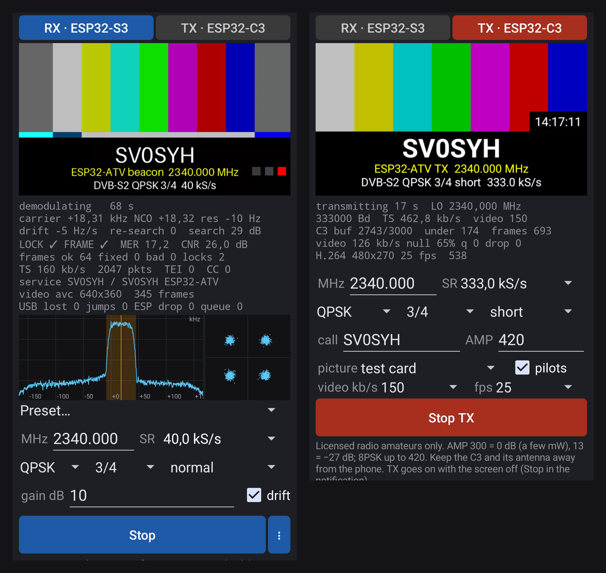

# ESP32-ATV

[](https://github.com/ok1cdj/ESP32-ATV/actions/workflows/android.yml)
[](https://buymeacoffee.com/ok1cdj)

> [!WARNING]
> **This equipment transmits on the 13 cm amateur radio band (2.3–2.45 GHz). Using it requires an amateur radio
> licence.** Transmit only with your own callsign, on frequencies and at power levels your licence and national band
> plan allow (2345 MHz lies in the ATV segment of the IARU Region 1 band plan). The 2.4 GHz part of the band is shared
> with Wi-Fi and other services – without a licence, transmitting here is illegal and can disturb other users. The
> receiver alone needs no licence.
>
> **Zařízení vysílá v radioamatérském pásmu 13 cm (2,3–2,45 GHz). K vysílání je nutné platné oprávnění
> (koncese) radioamatéra.** Vysílejte jen se svou značkou, na kmitočtech a s výkonem, které vaše oprávnění a národní
> kmitočtový plán dovolují. Bez koncese je vysílání nezákonné a může rušit ostatní uživatele pásma (Wi-Fi apod.).
> Samotný příjem koncesi nevyžaduje.

DATV on 13 cm with ESP32 boards: a stand-alone **ESP32-C3 DVB-S2 beacon** and **ATV RX/TX**, a receiver made of a
**XIAO ESP32-S3** on USB-OTG and an **Android** phone or tablet (beta). The app also **transmits** through a XIAO
ESP32-C3 on USB-OTG: test card, camera or a picture / video file, DVB-S2 QPSK / 8PSK encoded on the phone (`android/native/dvbs2enc`).

- **Guide / návod:** <https://ok1cdj.github.io/ESP32-ATV/> ([English](docs/rx-android.en.md), [česky](docs/rx-android.cs.md))
- **APK:** [Releases](https://github.com/ok1cdj/ESP32-ATV/releases) ([changelog](CHANGELOG.md)) · **S3 firmware:** [web flasher](https://ok1cdj.github.io/ESP32-ATV/flasher/)
- **Transmitting: licensed radio amateurs only** (see above). GNU GPL v3 ([LICENSE](LICENSE)); third-party parts keep their licences (below).

<p align="center"></p>

```
XIAO ESP32-C3 (ESP32-DATV-SA beacon, DVB-S2 QPSK 3/4, 40–500 kS/s, 2345.000 MHz)
   ~ 13 cm ~>
XIAO ESP32-S3 (ESP32-DATV-RX firmware: radio dump 16 MS/s -> 500 ksps cs4 / 333 ksps cs8 over native USB)
   -> Android: ATV RX/TX (leandvb + ldpc_tool, MediaCodec)      or      PC: rx/rx.sh (rx_dvbs2.py, leandvb, ffplay)
```

| Part | Project | Licence |
|---|---|---|
| TX firmware | [ok1cdj/ESP32-DATV-SA](https://github.com/ok1cdj/ESP32-DATV-SA), fork of [barisdinc/ESP32-DATV-SA](https://github.com/barisdinc/ESP32-DATV-SA) (`third_party/`) | PolyForm Noncommercial |
| RX firmware + PC receiver | [ok1cdj/ESP32-DATV-RX](https://github.com/ok1cdj/ESP32-DATV-RX), fork of [barisdinc/ESP32-DATV-RX](https://github.com/barisdinc/ESP32-DATV-RX) (`third_party/`) | BSD-3 / 0BSD, leansdr GPL-3 |
| Android app, scripts | this repository (`android/`, `tx/`, `rx/`) | GPL-3 |

## Credits

This project stands on the work of others – thank you:

- **SP8ESA** – [ESP32-DATV](https://github.com/SP8ESA/ESP32-DATV): the idea and the DVB-S / DVB-S2 modulator that
  transmits with the ESP32-C3's own Wi-Fi RF hardware.
- **Baris Dinc** – [ESP32-DATV-SA](https://github.com/barisdinc/ESP32-DATV-SA) (stand-alone beacon) and
  [ESP32-DATV-RX](https://github.com/barisdinc/ESP32-DATV-RX) (the receive chain on the PC).
- **h0m3us3r** – [eSpDR](https://github.com/h0m3us3r/eSpDR): the ESP32-S3 radio dump at 16 MS/s used as an SDR.
- **Jochen Hammes** – [esp32-sdr-trx](https://github.com/jochenhammes/esp32-sdr-trx): the one-board receiver firmware.
- **pabr** – [leansdr / leandvb](https://github.com/pabr/leansdr): the DVB-S2 demodulator.
- **Ahmet Inan** – [LDPC](https://github.com/xdsopl/LDPC) and **Blockstream** – [its fork](https://github.com/Blockstream/LDPC):
  `ldpc_tool` and the DVB-S2 LDPC tables used by our encoder.
- **lieff** – [minimp3](https://github.com/lieff/minimp3): MP2 / MP3 sound decoding.

If you like the project: [Buy Me a Coffee](https://buymeacoffee.com/ok1cdj) ☕

## Forks

Both projects in `third_party/` are our forks: branch **`esp32-atv`** with our commits, the original repository is the
remote `upstream`. Update: `git -C third_party/<repo> fetch upstream && git -C third_party/<repo> rebase upstream/main`.

| Fork | Changes |
|---|---|
| ESP32-DATV-SA | beacon 40–500 kS/s (rate table, default rate from `BEACON_BAUD`, `make_beacon.py`); DC/IQ correction of the beacon (`--cal`, `BDC` command); DVB-S2 short frames (`--frame short`); branch `xiao-panel` (the one used here): front panel pins for the XIAO ESP32-C3, upstream's video from the flash merged, loops from the flash at any rate / QPSK code rate / frame size with frequency and level (header version 3), `VIDW` to store a loop over USB, `CONFIG_DATV_BUILTIN_BEACON=n` for the web build, `FW` line in `INFO` |
| ESP32-DATV-RX | `rx_dvbs2.py --sampler auto/linear/rrc`, `--rrc-rej` (RRC below 100 kS/s), `--device`, `--frame normal/short/auto`, DC removal in the 8-bit mode, MER / CNR in the status line, `--decimate` (experimental) |

## One-time setup (PC, Linux)
```sh
git submodule update --init --recursive
sh third_party/ESP32-DATV-RX/tools/install.sh      # venv (espdr, esptool), leandvb, ldpc_tool
sudo cp third_party/ESP32-DATV-RX/esp32-sdr-trx/udev/70-espdr.rules /etc/udev/rules.d/ \
  && sudo udevadm control --reload && sudo udevadm trigger   # keeps ModemManager off the port (any byte stops the stream)
# ESP-IDF for the C3 (v6.1)
git clone --depth 1 -b v6.1 --recursive --shallow-submodules https://github.com/espressif/esp-idf ~/esp/esp-idf-v6.1
~/esp/esp-idf-v6.1/install.sh esp32c3
```
Board ports are told apart by MAC address in `boards.sh` (both boards are `303a:1001`); edit it for your boards.

## Frequency
One place: `ATV_FREQ` in `boards.sh` – **2345.000 MHz**, the 2322–2355 MHz ATV segment of the IARU Region 1 band plan
(check your national rules). Used by `tx/make_beacons.sh`, `tx/tx_pc.sh`, `rx/rx.sh`, `rx/level_sweep.sh`,
`rx/cal_dc.py`; the app defaults to it. **Avoid multiples of 20 MHz** (2320, 2340, 2360 …): the XIAO ESP32-S3's PLL has
a spur exactly there, 12–28 dB above the noise (strongest on multiples of 40 MHz), which lands inside the signal – also
on another frequency, keep the carrier a few hundred kHz away from them. 2340.000 MHz was used until 2026-10-16.

## Transmitter – XIAO ESP32-C3
**For everyone:** the firmware from the web (the app's menu ⋮ → Firmware, or the [web flasher](https://ok1cdj.github.io/ESP32-ATV/flasher/))
transmits nothing until a beacon is stored: the app's TX screen → *Save as beacon in the C3* (records the test card, the
camera or your picture / video with your settings and stores the loop; the C3 then transmits it by itself), or from a PC:
```sh
python3 tx/make_flash_loop.py video.mp4 --baud 40000 --frame short --call YOURCALL --freq 2345 --amp 300 -o loop.bin
third_party/ESP32-DATV-RX/.venv/bin/python tx/c3_vidw.py loop.bin     # VIDW over USB (TX_PORT of boards.sh); --erase removes it
. ~/esp/esp-idf-v6.1/export.sh && tx/build_c3_web.sh                     # the web build (no built-in beacon) -> build/c3-web/out
```
The Pages workflow builds that firmware (ESP-IDF 6.1 container) and writes the manifests both the web flasher and the
app read (`tx/make_fw_site.py`, with sha256 and version).

**For development – a firmware with a built-in test card:**
```sh
CALL=YOURCALL tx/make_beacons.sh 50000   # test card + SDT with your callsign -> tx/beacons/yourcall-50k/ (AMP=300: 0 dB)
. ~/esp/esp-idf-v6.1/export.sh
tx/flash_tx.sh tx/beacons/yourcall-50k   # builds in build/tx-firmware (the submodule stays clean) and flashes
```
Check: the C3 serial console command `INFO`. Rates: 40000 50000 66666 100000 125000 250000 333000 400000 500000 – the
loop runs at 8 MS/s with a whole number of 16–232 samples per symbol; below 125 kS/s it holds 2 PLFRAMEs so that the
modulator tables (256 B × S) fit on the heap. Other modulations (8PSK …) or rates: PC mode `tx/tx_pc.sh 33000`.

### Short frames (faster first picture at low rates)
```sh
FRAME=short tx/make_beacons.sh 40000     # -> tx/beacons/<call>-40k-short/, DVB-S2 short FECFRAMEs (16200 bits)
```
The receiver's LDPC decoder (ldpc_tool) works on batches of 32 frames. Short frames are 4× shorter, so a batch fills 4×
sooner: in simulation at 40–66 kS/s the first picture came after 5–8 s instead of 40–60 s (the first, partial batch of
normal frames is usually lost), at the same threshold (QPSK 3/4: Es/N0 ≈ 4.5 dB for both). Receive with the *… short* presets in the app or `rx/rx.sh 40000 --frame short`. Details:
[short frames](docs/2026-10-15-short-frames.en.md).

### DC correction (carrier leakage)
The C3 leaks its carrier (a tone in the middle of the signal, about −34 dBc) at a fixed level, which limits reception at
low levels. Calibrate it with the receiver (S3 on the PC, or both boards on a hub with the app: menu ⋮ → *Transmitter
calibration*). The new method transmits the leakage alone (`BDC TEST`, firmware of 2026-10-16) and takes about 20 s:
```sh
PY=third_party/ESP32-DATV-RX/.venv/bin/python
$PY rx/cal_dc.py --mode test                    # ATV_FREQ, about 20 dB off; the result only
$PY rx/cal_dc.py --mode test --boots 5 --save   # the mean of 5 starts of the C3 into its table (NVS) and tx/cal_c3.json
```
The leakage moves by about 2 DAC codes each time the C3 starts, hardly with the frequency: a stored value takes off about
9 dB, a calibration just before transmitting about 20 dB ([LO calibration](docs/2026-10-16-lo-calibration.en.md)).
The old method, the beacon at a low level, is still there: `AMP=13 tx/make_beacons.sh 40000 && tx/flash_tx.sh
tx/beacons/<call>-40k`, then `$PY rx/cal_dc.py --save`. `tx/make_beacons.sh` bakes `tx/cal_c3.json` into every beacon.
By hand on the C3's USB: `BDC [GET [f] | i q | SAVE | PUT f i q | LIST | RESET | TEST on [f] | off]`.

## Receiver – Android (ATV RX/TX)
See the [guide](docs/rx-android.en.md). Build it yourself:
```sh
android/native/build-native.sh        # leandvb, ldpc_tool, the DVB-S2 encoder and minimp3 for arm64 with the NDK (fetches the sources itself)
cd android && ./gradlew assembleDebug
```

## Transmitter – Android (TX)
Switch **RX | TX** in the app, the C3 on OTG instead of the S3: test card, camera or a picture / video
file → H.264, microphone and / or the callsign in Morse or the video's sound → AAC (HE-AAC at low rates) → TS (time stamps from the capture clock) → our DVB-S2 encoder
(`android/native/dvbs2enc`, C, GPL) → the C3's PC streaming mode. See the [guide](docs/rx-android.en.md#5-transmitting-from-the-phone-tx-beta).
On a PC: `tx/tx_s2enc.py TS_FILE` streams a TS through the C3 with the same encoder; `rx/test_dvbs2enc.py` checks the
encoder bit for bit against ESP32-DATV's encoders and decodes it with leandvb. `tx/mux_selftest.sh` (debug build)
records the phone's TX mux without the C3 – a white flash and a beep every 2 s – and `tx/avsync.py` measures its lip sync.

## Receiver – PC (XIAO ESP32-S3, one USB-C port)
1. U.FL antenna. Hold BOOT, tap RESET, release BOOT.
2. `rx/flash_rx_xiao.sh` – the receiver firmware into the flash (or the [web flasher](https://ok1cdj.github.io/ESP32-ATV/flasher/)). After a reset: `lsusb | grep 303a:1001`.
3. Receive:
   - `rx/rx.sh` – beacon 333 kS/s, `--wide` mode (500 ksps, 4 bit)
   - `rx/rx.sh 125000` – 125 kS/s (333 ksps, 8 bit)
   - `rx/rx.sh 66666` / `50000` / `40000` – low rates: 8 bit, RRC sampler of leandvb below 100 kS/s; the first picture
     after ~32 frames (66 kS/s ≈ 16 s), with `--ldpc bitflip` at once but ~5 dB less sensitive
   - `rx/rx.sh 40000 --frame short` – a beacon with short frames (`FRAME=short tx/make_beacons.sh 40000`)
   - options: `--gain 10`, `--ppm X`, `--record x.ts`, `--no-sound`, `-v`
   - sound plays with the picture when the service has it (ffplay on the TS, synchronised to the sound); a service
     without sound (the built-in beacon) is retimed by ffmpeg as before
4. Spectrum: `rx/spectrum.sh`, SDR++ / SDRangel on `127.0.0.1:1234` (rtl_tcp).

Other tools: `rx/level_sweep.sh` (sensitivity sweep, `FRAME=short` for short frames), `rx/sim_frames.py` (normal vs short frames simulated end to end), `rx/raw2cf32.py` (raw packets recorded by the app -> cf32, decode), `rx/make_replay.py` (a recording for the app's *Replay* from any TS, no radio needed: our DVB-S2 encoder, offset, noise), `rx/avsync_rx.py` (the app's lip sync on such a replay, debug build).

## Test without hardware
```sh
PY=third_party/ESP32-DATV-RX/.venv/bin/python
NS=$(grep -oP 'BEACON_SYMBOLS\s+\K[0-9]+' tx/beacons/yourcall-333k/beacon_cfg.h)
$PY rx/sim_beacon.py tx/beacons/yourcall-333k/beacon.bin -o build/beacon_ref.cf32 --loops 20 --sps 3 --baud 333333.3333 --symbols $NS
$PY third_party/ESP32-DATV-RX/tools/sim_wide.py build/beacon_ref.cf32 --fs-in 1000000 --fs-out 500000 --sr 333333 \
    --bits 4 --esn0 9 --repeat 1 --ldpc-helper third_party/ESP32-DATV-RX/build/LDPC/ldpc_tool
```
