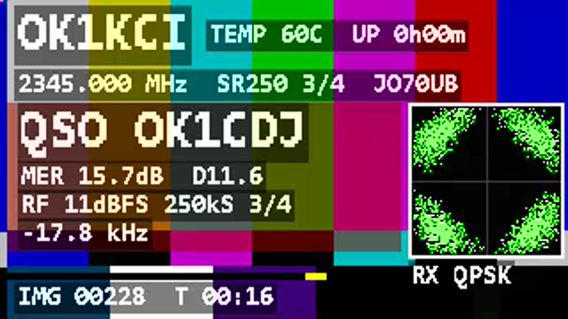

# ESP32-C5 jako transceiver: 13 cm a spojení s parrotem IZ7PDX

*14. 11. 2026 · [English](2026-11-14-c5-transceiver.en.md)*

## Co se testovalo

Větev `trx` (po v0.20-beta), na stole:

1. ESP32-C5 na **13 cm** (2345 MHz) při všech našich symbolových rychlostech;
2. vlastní GPL-3 tabulky modulátoru a smyčka 8PSK místo kódu z ESP32-DATV-SA;
3. **jedna C5 pro RX i TX**: obraz transceiveru (`tx/c5cw` s `rx/c5rx` uvnitř) a přepínání TX a RX na téže desce;
4. **spojení s parrotem IZ7PDX** (ESP32-S3-CAM PDX DATV beacon, náš fork s nízkými rychlostmi) jedinou C5;
5. únik nosné na obou pásmech.

## Sestava

- Dvě **Waveshare ESP32-C5-Zero** (MAC …B3:98 a …A3:A0) na USB počítače, několik dm od sebe, nalepovací antény z balení
  na U.FL. Napájení z PC.
- Vysílání z PC kodérem aplikace: `tx/tx_s2enc.py` (DVB-S2, TS z `tx/beacons/ok1cdj-*-6cm/beacon.ts`, služba OK1CDJ) přes
  `QPSKT`; symboly 8PSK z `build/s2enc/s2enc --const 8psk --format phase` přes `PSK8T`.
- Příjem na PC: `rx/c5_play.sh` (hledání signálu, `espdr nb.py` cs4, leandvb + ldpc_tool) s TS do souboru místo ffplay;
  počítáno: TS pakety, název služby (ffprobe), chyby kontinuity TS a TEI.
- QPSK 3/4, piloty, short rámce, pokud není uvedeno jinak; 32 s příjmu na běh.
- Parrot: IZ7PDX ESP32-S3-CAM, firmware v1.2.0 (náš fork), QRZ OK1KCI, 2345.000 MHz, 333 kS/s 3/4, úroveň −30 dB, cyklus
  20 s testovací obrazec + 40 s pauza, Parrot ON (poslouchá v pauzách, odpověď 30 s, ustálení 3 s). Ovládaný přes USB
  konzoli (`CONFIG`, `BEACON`); jeho log uložen.

## 1. Dvě C5 na 13 cm (2345 MHz)

Vysílač C5 (c5cw v0.20-beta) a přijímač (c5rx) bez změny kódu: oba firmwary už berou 2300–5900 MHz.

| Symbolová rychlost | Šířka (−6 dB) | Odskok | TS paketů / 32 s | Chyby TS | Pozdní vzorky TX |
|---|---|---|---|---|---|
| 250k QPSK | 271 kHz | +28,7 kHz | 7176 | 0 | 0 |
| 125k QPSK | 137 kHz | +21,1 kHz | 3463 | 0 | – |
| 100k QPSK | 109 kHz | +18,2 kHz | 2721 | 0 | 0 |
| 66,7k QPSK | 75 kHz | +14,8 kHz | 1731 | 0 | 0 |
| 50k QPSK | 57 kHz | +15,2 kHz | 954 | 0 | 0 |
| 40k QPSK | 48 kHz | +13,1 kHz | 989 | 0 | 0 |
| 250k 8PSK 2/3 | 270 kHz | +12,7 kHz | 9855 | 0 | 0 |
| pro srovnání 5715 MHz, 250k QPSK | 273 kHz | +33,1 kHz | 7177 | 0 | 0 |

C5 funguje na 13 cm stejně jako na 6 cm; krystaly obou desek jsou na 2,3 GHz od sebe +13…+29 kHz (stejné ppm jako na
6 cm). „–“: vysílací skript tehdy nevypsal souhrn vysílače (čeká na něj jen 3 s), nahrávka je čistá.

## 2. Únik nosné

`tx/c5_dccal.py` (zisk přijímače 10, neuloženo):

| Kmitočet | Čára úniku (od LO přijímače) | Nalezená korekce (kódy DAC) | Potlačení |
|---|---|---|---|
| 2345 MHz | +14 kHz | −1,2, +1,0 | 6–10 dB |
| 5715 MHz | +34 kHz | ~+0,5…+1,0, +1,1 | 6–10 dB |

Únik je asi 1,5 kódu DAC, ≈ −40 dB pod špičkou majáku (150 kódů), na obou pásmech. Přímé měření v dBc přes záznam
přijímače (`CW 0 0` proti `CW 150 0` / `CW 30 0`) vycházelo nekonzistentně (−44 a −88 dB pro tentýž únik; při zisku 0
přijímač chytil vlastní čáru na −6 kHz): nepoužito. Absolutní hodnotu je třeba změřit spektrálním analyzátorem.

## 3. Vlastní tabulky modulátoru

`tx/common/rrc_tables.h` a `tx/common/frac_clock.h` (GPL-3, napsané od nuly) nahrazují `qpsk_lut.h`, `sample_clock.h`
a zkopírovanou `rrc_pulse()` z ESP32-DATV-SA (PolyForm Noncommercial); nová je i smyčka 8PSK.

- Na PC jsou nové tabulky se starými shodné na každý kód: QPSK S 8 / 16 (dvě skupiny po čtyřech symbolech), S 12 / 16 / 24 /
  48 (čtyři skupiny po dvou), 8PSK S 9 / 12 / 19 / 60, s DC 0 i (−1,7, +2,3).
- Na vzduchu (5715 MHz): uložená smyčka 40k, živě QPSK 250k / 125k / 40k (7176 / 3464 / 742 TS paketů), živě 8PSK
  250k / 125k (9855 / 4703), 2345 MHz QPSK 250k (7176): vše bez chyby TS. Nová smyčka 8PSK má nejhorší zpoždění 40–41 cyklů
  (dřív 58), žádný pozdní vzorek.

## 4. Jedna C5 pro RX i TX

Obě C5 s obrazem transceiveru (přijímač a vysílač v jednom, INFO `ESP32DATV 1 C5 RXTX`):

| Směr | Běh | TS paketů / 32 s | Chyby TS |
|---|---|---|---|
| B3 → A3 | 5715 MHz, 250k QPSK | 7176 | 0 |
| B3 → A3 | 2345 MHz, 125k QPSK | 3463 | 0 |
| A3 → B3 (B3 předtím vysílala) | 5715 MHz, 250k QPSK | 7176 | 0 |
| B3 → A3 (B3 předtím přijímala, A3 vysílala) | 2345 MHz, 250k QPSK | 7176 | 0 |
| B3 → A3 | 5715 MHz, 250k 8PSK 2/3 | 9855 | 0 |

Každá deska přepínala TX → RX i RX → TX bez resetu. Smyčka 1,67 MB uložená přes `VIDW` (kontrola CRC) na obrazu
transceiveru funguje.

Cestou se ukázalo: největší volný blok paměti v obrazu transceiveru je 120 KB, takže `CAP 32768` přijímače (128 KB, hledání
signálu v `rx/c5_play.sh`) selhal; `CAP` teď vezme méně vzorků, když se buffer nevejde (24576), a řekne kolik.

## 5. Spojení s parrotem IZ7PDX – jedna C5

Skript na stole (není v repozitáři): počká v logu parrotu na pauzu s posloucháním, odvysílá z C5 A3:A0 výzvu 25 s, počká na odpověď
parrotu a pak ji 35 s přijímá na **téže C5**.

**První spojení (7:58, 250 kS/s, normal rámce)**

| Čas | |
|---|---|
| 07:58:31 | parrot začíná poslouchat; C5 vysílá výzvu (služba OK1CDJ) |
| 07:58:35 | parrot našel signál: 16,8 dB nad šumem, −17,4 kHz („silný signál“, snížil si zisk) |
| 07:58:43 | zaznamenává 2 s při 1 Msps a dekóduje |
| 07:58:57 | přečtena značka OK1CDJ |
| 07:59:02 | **QSO OK1CDJ: MER 15,7 dB, D 11,6**, LDPC 14/14, 449 TS paketů bez chyby, −17,8 kHz |
| 07:59:03 | tatáž C5 přijímá; odpověď na +21 kHz |
| 07:59:39 | **6168 TS paketů, 0 chyb**: služba OK1KCI, provider „QRK OK1CDJ 15.7dB D11.6“, H.264 320×180 + AAC |

**Všechny symbolové rychlosti** (QPSK 3/4, piloty):

| Rychlost / rámce | Parrot dekódoval výzvu | C5 přijala odpověď |
|---|---|---|
| 333k normal | ✅ MER 15,5 dB, LDPC 19/19 | ✖ nad 250k přijímače C5 |
| 250k normal | ✅ MER 15,7 dB, LDPC 14/14 | ✅ 6168 paketů, 0 chyb |
| 125k normal (2×, jednou s výzvou 35 s) | ✖ MER 15,8 dB, LDPC 0/7 a 1/6 | – bez odpovědi |
| 125k short | ✅ MER 15,8 dB | ✅ 3216 paketů, 0 chyb |
| 100k short | ✅ MER 15,2 dB, LDPC 23/23 | ✅ 2474 paketů, 0 chyb |
| 66,7k short | ✅ MER 21,1 dB, LDPC 31/31 | ✅ 1732 paketů, 0 chyb |
| 50k short | ✅ MER 20,0 dB, LDPC 23/23 | ✅ 1237 paketů, 0 chyb |
| 40k short | ✅ MER 19,7 dB, LDPC 18/18 | ✅ 725 paketů, jeden krátký výpadek (4 přerušení kontinuity na jednom místě) |

Zjištění:
- **Parrot odpovídá symbolovou rychlostí a typem rámců výzvy.** Na výzvu se short rámci přijde odpověď se short rámci
  a přijímač na ně musí být nastavený (naši první odpověď na 125k short jsme minuli s přijímačem na normal).
- **125k s normal rámci selhalo na straně parrotu**, při dobrém signálu: tentýž signál 125k normal přijímač C5 dekóduje
  bez chyby. Do 2 s záznamu se při 125k vejde jen asi 7 normal rámců. Na 125k volat se short rámci.
- **Pod 100k naměřil parrot vyšší MER** (~20 dB proti ~15,5 dB): užší pásmo a menší přebuzení na krátkou vzdálenost (na
  vyšších rychlostech hlásil silný signál a snižoval zisk).
- 333k funguje jen směrem k parrotu; jeho odpověď by potřebovala přijímač nad 250k.

**Z telefonu (10:22, aplikace 0.20.1-trx, jedna C5 transceiver na OTG):** parrot přepnutý na maják 250 kS/s; výzva přes
Start TX (2345.000 MHz, 250k QPSK 3/4 normal, služba OK1CDJ, poskytovatel „OK1CDJ JO70UB ESP32-ATV“, obraz i zvuk), pak
obrazovka RX na téže desce. Parrot: první záznam nedekódoval (signál se ještě ustaloval), druhý 17 dB nad šumem, značka
přečtena, **MER 15,7 dB, D 11,7, LDPC 59/59**, 455 TS paketů bez chyby (QSO 9); jeho odpověď (30 s) přijata v telefonu.

## Zatím neotestováno
- Příjem majáku C3 a S3 proti C5 na 13 cm (zatím jen C5 ↔ C5 a parrot).
- Výstupní výkon (chybí kabel k analyzátoru).

## Soubory

Na PC u stolu (ne v repozitáři): `build/qso/` – odpovědi jako `.ts`, první i jako `.mp4` a obrázek výše, log obou stran
a celý log konzole parrotu.
