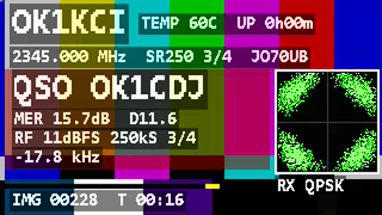

# The ESP32-C5 as a transceiver: 13 cm and a QSO with the IZ7PDX parrot

*2026-11-14 · [česky](2026-11-14-c5-transceiver.cs.md)*

## What was tested

Branch `trx` (after v0.20-beta), on the bench:

1. the ESP32-C5 on **13 cm** (2345 MHz) at all our symbol rates;
2. our own GPL-3 modulator tables and 8PSK loop in place of ESP32-DATV-SA's code;
3. **one C5 for RX and TX**: the transceiver image (`tx/c5cw` with `rx/c5rx` in it) and switching between TX and RX on the
   same board;
4. a **QSO with the IZ7PDX parrot** (ESP32-S3-CAM PDX DATV beacon, our fork with low symbol rates) made with a single C5;
5. the carrier leakage on both bands.

## Setup

- Two **Waveshare ESP32-C5-Zero** (MAC …B3:98 and …A3:A0) on USB of a PC, a few dm apart, the boards' stick-on antennas
  on U.FL. Powered from the PC.
- Transmitting from the PC with the app's encoder: `tx/tx_s2enc.py` (DVB-S2, the TS of `tx/beacons/ok1cdj-*-6cm/beacon.ts`,
  service OK1CDJ) through `QPSKT`; 8PSK symbols from `build/s2enc/s2enc --const 8psk --format phase` through `PSK8T`.
- Receiving on the PC: `rx/c5_play.sh` (signal search, `espdr nb.py` cs4, leandvb + ldpc_tool) with the TS written to a file
  instead of ffplay; counted: TS packets, service name (ffprobe), TS continuity errors and TEI.
- QPSK 3/4, pilots, short frames unless stated; 32 s of reception per run.
- The parrot: IZ7PDX ESP32-S3-CAM, firmware v1.2.0 (our fork), QRZ OK1KCI, 2345.000 MHz, 333 kS/s 3/4, level −30 dB,
  cycle 20 s test card + 40 s pause, Parrot ON (listens in the pauses, reply 30 s, settling 3 s). Controlled over its USB
  console (`CONFIG`, `BEACON`); its log kept.

## 1. Two C5s on 13 cm (2345 MHz)

The C5 transmitter (c5cw v0.20-beta) and receiver (c5rx), no code change: both firmwares already take 2300–5900 MHz.

| Symbol rate | Width (−6 dB) | Offset | TS packets / 32 s | TS errors | Late TX samples |
|---|---|---|---|---|---|
| 250k QPSK | 271 kHz | +28.7 kHz | 7176 | 0 | 0 |
| 125k QPSK | 137 kHz | +21.1 kHz | 3463 | 0 | – |
| 100k QPSK | 109 kHz | +18.2 kHz | 2721 | 0 | 0 |
| 66.7k QPSK | 75 kHz | +14.8 kHz | 1731 | 0 | 0 |
| 50k QPSK | 57 kHz | +15.2 kHz | 954 | 0 | 0 |
| 40k QPSK | 48 kHz | +13.1 kHz | 989 | 0 | 0 |
| 250k 8PSK 2/3 | 270 kHz | +12.7 kHz | 9855 | 0 | 0 |
| 5715 MHz for comparison, 250k QPSK | 273 kHz | +33.1 kHz | 7177 | 0 | 0 |

The C5 works on 13 cm as on 6 cm; the two crystals are +13…+29 kHz apart at 2.3 GHz (the same ppm as on 6 cm). "–": the
transmit script did not print the transmitter's summary that time (it waits only 3 s for it), the recording is clean.

## 2. Carrier leakage

`tx/c5_dccal.py` (receiver gain 10, not saved):

| Frequency | Leakage line (from the RX LO) | Trim found (DAC codes) | Reduction |
|---|---|---|---|
| 2345 MHz | +14 kHz | −1.2, +1.0 | 6–10 dB |
| 5715 MHz | +34 kHz | ~+0.5…+1.0, +1.1 | 6–10 dB |

The leakage is about 1.5 DAC codes, ≈ −40 dB under the beacon's peak level (150 codes), on both bands. A direct dBc
measurement through the receiver's capture (`CW 0 0` against `CW 150 0` / `CW 30 0`) was inconsistent (−44 and −88 dB for
the same leakage; at gain 0 the receiver's own line at −6 kHz was taken): it is not used. The absolute value needs a
spectrum analyser.

## 3. Our own modulator tables

`tx/common/rrc_tables.h` and `tx/common/frac_clock.h` (GPL-3, written from scratch) replace `qpsk_lut.h`, `sample_clock.h`
and the copied `rrc_pulse()` of ESP32-DATV-SA (PolyForm Noncommercial); the 8PSK loop is new too.

- On the PC the new tables equal the old ones code for code: QPSK S 8 / 16 (two groups of four symbols), S 12 / 16 / 24 / 48
  (four groups of two), 8PSK S 9 / 12 / 19 / 60, with DC 0 and (−1.7, +2.3).
- On the air (5715 MHz): stored loop 40k, live QPSK 250k / 125k / 40k (7176 / 3464 / 742 TS packets), live 8PSK 250k / 125k
  (9855 / 4703), 2345 MHz QPSK 250k (7176): all without a TS error. The new 8PSK loop is at worst 40–41 cycles late (58
  before), no late sample.

## 4. One C5 for RX and TX

Both C5s with the transceiver image (receiver and transmitter in one, INFO `ESP32DATV 1 C5 RXTX`):

| Direction | Run | TS packets / 32 s | TS errors |
|---|---|---|---|
| B3 → A3 | 5715 MHz, 250k QPSK | 7176 | 0 |
| B3 → A3 | 2345 MHz, 125k QPSK | 3463 | 0 |
| A3 → B3 (B3 had transmitted) | 5715 MHz, 250k QPSK | 7176 | 0 |
| B3 → A3 (B3 had received, A3 had transmitted) | 2345 MHz, 250k QPSK | 7176 | 0 |
| B3 → A3 | 5715 MHz, 250k 8PSK 2/3 | 9855 | 0 |

Each board switched TX → RX and RX → TX without a reset. A 1.67 MB loop stored with `VIDW` (CRC checked) worked on the
transceiver image.

Found on the way: the transceiver image's largest heap block is 120 KB, so the receiver's `CAP 32768` (128 KB, the signal
search of `rx/c5_play.sh`) failed; `CAP` now takes fewer samples when the buffer does not fit (24576) and says how many.

## 5. QSO with the IZ7PDX parrot – one C5

A bench script (not in the repository): wait for the parrot's listening pause in its log, transmit the call from C5 A3:A0 for 25 s, wait
for the parrot's reply, then receive it on **the same C5** for 35 s.

**First QSO (07:58, 250 kS/s, normal frames)**

| Time | |
|---|---|
| 07:58:31 | the parrot starts listening; the C5 transmits the call (service OK1CDJ) |
| 07:58:35 | the parrot finds the signal: 16.8 dB over the noise, −17.4 kHz ("strong signal", it lowered its gain) |
| 07:58:43 | it captures 2 s at 1 Msps and decodes |
| 07:58:57 | callsign OK1CDJ read |
| 07:59:02 | **QSO OK1CDJ: MER 15.7 dB, D 11.6**, LDPC 14/14, 449 TS packets without an error, −17.8 kHz |
| 07:59:03 | the same C5 receives; the reply at +21 kHz |
| 07:59:39 | **6168 TS packets, 0 errors**: service OK1KCI, provider "QRK OK1CDJ 15.7dB D11.6", H.264 320×180 + AAC |

**All symbol rates** (QPSK 3/4, pilots):

| Symbol rate / frames | The parrot decoded the call | The C5 received the reply |
|---|---|---|
| 333k normal | ✅ MER 15.5 dB, LDPC 19/19 | ✖ above the C5 receiver's 250k |
| 250k normal | ✅ MER 15.7 dB, LDPC 14/14 | ✅ 6168 packets, 0 errors |
| 125k normal (twice, once with a 35 s call) | ✖ MER 15.8 dB, LDPC 0/7 and 1/6 | – no reply |
| 125k short | ✅ MER 15.8 dB | ✅ 3216 packets, 0 errors |
| 100k short | ✅ MER 15.2 dB, LDPC 23/23 | ✅ 2474 packets, 0 errors |
| 66.7k short | ✅ MER 21.1 dB, LDPC 31/31 | ✅ 1732 packets, 0 errors |
| 50k short | ✅ MER 20.0 dB, LDPC 23/23 | ✅ 1237 packets, 0 errors |
| 40k short | ✅ MER 19.7 dB, LDPC 18/18 | ✅ 725 packets, one short gap (4 continuity breaks in one place) |

Findings:
- **The parrot answers with the call's symbol rate and frame size.** A call with short frames gets a reply with short
  frames, and the receiver has to be set to them (our first 125k short reply was missed with the receiver on normal).
- **125k with normal frames failed on the parrot's side**, with a good signal: the same 125k normal signal is decoded by
  the C5 receiver without an error. A 2 s capture holds only about 7 normal frames at 125k. Call with short frames at 125k.
- **Below 100k the parrot measured a higher MER** (~20 dB against ~15.5 dB): a narrower band, and less overload at short
  range (at the higher rates it reported a strong signal and lowered its gain).
- 333k works towards the parrot only; its reply needs a receiver above 250k.

## Not tested yet

- The QSO from the phone (Start TX, then the RX screen on the same transceiver) – the app has the transceiver role, not
  tried on the phone with it yet.
- 13 cm reception of the C3 beacon and of the S3 against the C5 (only C5 ↔ C5 and the parrot so far).
- The output power (no cable to an analyser).

## Files

On the bench PC (not in the repository): `build/qso/` – the replies as `.ts`, the first one as `.mp4` and the picture above,
the log of both sides and the parrot's whole console log.
