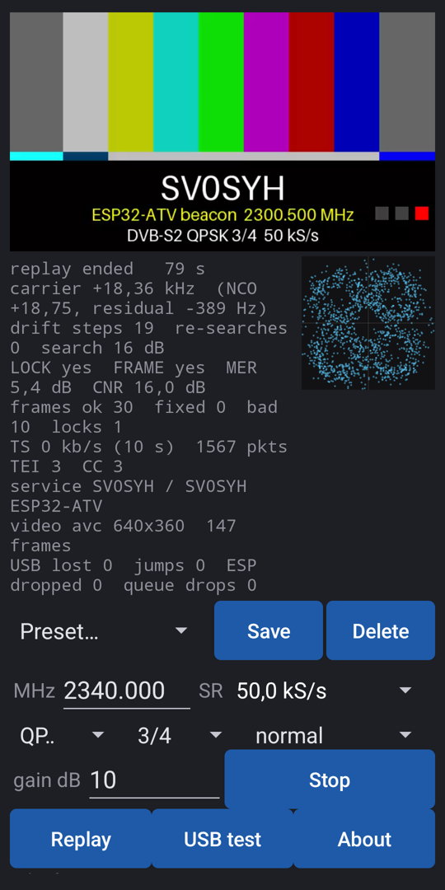
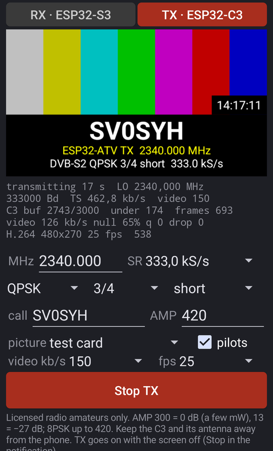

**ATV RX** je přijímač DVB-S2 pro amatérskou televizi v pásmu 13 cm. Rádiem je **Seeed XIAO ESP32-S3** připojený přes
USB-OTG, **telefon nebo tablet s Androidem** signál demoduluje (leandvb), dekóduje LDPC (ldpc_tool) a ukazuje obraz
spolu s MER, konstelací a údaji o streamu. Protějškem je samostatný maják s ESP32-C3
([ESP32-DATV-SA](https://github.com/ok1cdj/ESP32-DATV-SA)) – a stejná aplikace také **vysílá**: s XIAO ESP32-C3 na
USB-OTG posílá živě testkartu nebo obraz z kamery telefonu jako DVB-S2 (přepínač **RX | TX** nahoře).

> **Beta.** Vysílat smí jen radioamatéři s platným oprávněním, na kmitočtech podle národních podmínek a band plánu.
> Přijímač je ke stažení zdarma pod GNU GPL v3.



## Co potřebuješ

| díl | poznámka |
|---|---|
| **Seeed XIAO ESP32-S3** nebo **S3 Plus** | s externí anténou na U.FL (na 2.3 GHz – anténa z Wi-Fi sady stačí na stůl) |
| **USB-C OTG** kabel nebo redukce | telefon musí umět USB host (OTG); S3 se napájí z telefonu |
| **Android 9+**, procesor **arm64** | testováno: OnePlus 10 Pro (Android 16) |
| počítač s **Chrome / Edge** | jen jednou, na nahrání firmwaru do S3 |
| pro TX: **Seeed XIAO ESP32-C3** | s firmwarem [ESP32-DATV-SA](https://github.com/ok1cdj/ESP32-DATV-SA) a anténou na U.FL |

## 1. Firmware přijímače do ESP32-S3 (jednou)

**Webem (nejjednodušší):** otevři [webový flasher](flasher/) v Chrome nebo Edge na počítači, připoj XIAO datovým
kabelem, drž **BOOT**, ťukni **RESET**, pusť BOOT, klikni na *Install*, vyber port a potvrď. Po dokončení ťukni
**RESET**. Deska se pak hlásí jako `303a:1001` a přijímač startuje sám po každém zapnutí.

**Z příkazové řádky** (z tohoto repozitáře, Linux): `third_party/ESP32-DATV-RX/tools/install.sh` a pak
`rx/flash_rx_xiao.sh` (desku dej do režimu stahování stejně jako výše).

## 2. Aplikace

1. Stáhni APK z [Releases](https://github.com/ok1cdj/ESP32-ATV/releases) (soubor `atvrx-….apk`, kontrolní součet
   v `SHA256SUMS`).
2. Otevři ho v telefonu a povol instalaci z tohoto zdroje (*Instalovat neznámé aplikace*).
3. Při prvním spuštění povol **oznámení** – příjem běží ve službě na pozadí a v oznámení je jeho stav a tlačítko Stop.
4. Připoj S3 přes OTG. Android nabídne otevření ATV RX a zeptá se na **přístup k USB zařízení** – povol.

Aktualizace: nová verze z Releases se nainstaluje přes starou (stejný podpis).

## 3. Příjem

1. Nahoře zvol **Preset…** – např. *Beacon 50k QPSK 3/4* (kmitočet 2340.000 MHz, 50 kS/s). Předvolba nastaví kmitočet,
   symbolovou rychlost, modulaci, kódový poměr a velikost rámců; vlastní nastavení ulož tlačítkem **Save**.
2. **Gain**: na stole 10 dB, na vzdálenost 30 dB a víc. Při silném signálu a velkém zisku se přijímač zahltí (MER klesá,
   ztrácí zámek).
3. **Start.** Aplikace nejdřív sekundu hledá signál (FFT), naladí se na jeho střed a spustí demodulátor.
4. **První obraz** přijde, až ldpc_tool dekóduje první dávku 32 rámců: při 333 kS/s asi za 3 s, při 50 kS/s asi
   za 20 s, při 40 kS/s asi za 27 s (první neúplná dávka se často ztratí, takže v praxi i dvojnásobek). Pak už obraz
   běží plynule (zpožděný o tu dávku). Maják s **krátkými rámci** (`FRAME=short`) a předvolba *Beacon … short* zkrátí
   čekání čtyřikrát, na 5–8 s, při stejné citlivosti ([krátké rámce](https://github.com/ok1cdj/ESP32-ATV/blob/master/docs/2026-10-15-short-frames.cs.md)).

Obrazovku můžeš zhasnout nebo přepnout do jiné aplikace – příjem běží dál ve službě. Zastavíš ho tlačítkem **Stop**
v aplikaci nebo v oznámení.

### Co znamenají údaje

| řádek | význam |
|---|---|
| `carrier` | odchylka nosné od naladěného kmitočtu; `NCO` = softwarové doladění, `residual` = zbytek, který hlásí demodulátor |
| `drift steps` | kolikrát aplikace dorovnala drift oscilátorů (ESP32 nemají TCXO, při zahřívání se posouvají o kHz) |
| `re-searches` | kolikrát se signál ztratil a hledal znovu (10 s – u nízkých rychlostí 2,5 dávky LDPC – bez dobrého rámce) |
| `LOCK`, `FRAME` | zámek demodulátoru a rámcové synchronizace DVB-S2 |
| `MER` | modulation error ratio v dB – hlavní míra kvality; QPSK 3/4 potřebuje zhruba > 5 dB, 8PSK 3/5 > 10 dB |
| `CNR` | poměr nosná/šum (jen když vzorkování > 3× symbolová rychlost, tj. do 100 kS/s) |
| `frames ok / fixed / bad` | rámce bez chyb / opravené kódem BCH / nedekódované |
| `TS`, `TEI`, `CC` | tok transport streamu (průměr 10 s), pakety s chybou, nespojitosti čítače |
| `service`, `video` | název služby a poskytovatele z SDT, kodek a rozlišení |
| `USB lost`, `queue drops` | ztráty na USB a ve frontě k demodulátoru – mají být 0 |
| konstelace (čtverec) | body symbolů: QPSK 4 shluky, 8PSK 8 shluků; prstenec = málo signálu nebo fázový šum |

## 4. Vysílač (maják ESP32-C3)

Vysílač je fork [ESP32-DATV-SA](https://github.com/ok1cdj/ESP32-DATV-SA) (licence PolyForm Noncommercial).
Maják se generuje na PC **s tvou značkou** – v obraze testkarty i v názvu služby:

```sh
CALL=TVOJEZNACKA tx/make_beacons.sh 50000        # 50 kS/s; AMP=300 pro plnou úroveň (0 dB), výchozí −27 dB
. ~/esp/esp-idf-v6.1/export.sh && tx/flash_tx.sh tx/beacons/<značka>-50k
```

- Kmitočet je v `boards.sh` (`ATV_FREQ`, výchozí **2340.000 MHz** – ATV segment 2322–2355 MHz band plánu IARU R1).
  Ověř si národní podmínky.
- **DC kalibrace úniku nosné** (`rx/cal_dc.py --save`, S3 na PC) platí pro jeden kmitočet – po změně ji zopakuj.
- Beacon umí jen QPSK; 8PSK a živý obraz vysílá aplikace (kapitola 5) nebo PC
  (`third_party/ESP32-DATV-SA/host/tx_dvbs.py`).

## 5. Vysílání z telefonu (TX, beta)



Telefon sám zakóduje obraz (H.264), transport stream i DVB-S2 a posílá symboly do C3, který jen moduluje (jeho režim
s PC). C3 potřebuje firmware ESP32-DATV-SA (stejný jako pro maják výše: příkaz z USB maják zastaví a spustí živý režim).

1. Připoj **XIAO ESP32-C3** přes OTG místo S3 (jeden port: RX a TX se střídají). C3 s anténou dej **dál od telefonu** –
   položený vedle něj dával signál o 20 dB slabší a nedekódoval se.
2. Nahoře přepni na **TX**, povol přístup k USB (a ke kameře, když ji použiješ).
3. Nastav kmitočet (2300–2450 MHz, jinak ho firmware odmítne), symbolovou rychlost, **QPSK / 8PSK**, kódový poměr,
   velikost rámců (**short** dá při nízkých rychlostech první obraz 4× dřív), piloty, **značku**, **AMP** (300 = 0 dB,
   pár mW; 13 = −27 dB; 8PSK až 420) a **obraz**: testkarta, zadní nebo přední kamera.
4. **Start TX.** Aplikace si z C3 přečte jeho DC kalibraci (`BDC`) a spustí ho; ve stavu je zaplnění bufferu C3 (má
   se držet kolem 3000), rychlost TS a videa. TX běží na pozadí i se zhasnutým displejem; zastavíš ho **Stop TX**
   nebo v oznámení.

- **AMP** je špičková amplituda, kterou C3 budí modulátor, v kódech DAC (1–480) – digitální úroveň buzení, ne změřený
  výkon. Mění napětí: úroveň = 20·log₁₀(AMP / 300) dB.

  | AMP | úroveň | použití |
  |---|---|---|
  | 480 | +4 dB | maximum; čekej zkreslení (rozšíření spektra, nižší MER) |
  | 420 | +3 dB | výchozí pro 8PSK v PC nástrojích ESP32-DATV; hlídej MER na přijímači |
  | **300** | **0 dB** | výchozí pro QPSK, plná úroveň (pár mW, neměřeno) |
  | 95 / 30 | −10 / −20 dB | na stole s anténami blízko sebe (300 může přijímač zahltit) |
  | 13 | −27 dB | výchozí hodnota původního majáku; zkoušky citlivosti |

- Obraz z kamery se otáčí podle toho, jak telefon držíš (naležato vyplní celý rámec), a dole nese pruh se značkou
  a módem.
- Bitrate a snímková frekvence videa jsou automatické (asi 70 % rychlosti TS; 320×180 5 fps při 40–66 kS/s,
  640×360 15 fps při 333 kS/s), nebo je zadáš ručně.
- Přijímat můžeš druhým telefonem, PC (`rx/rx.sh 333000 --frame short`) nebo jakýmkoli přijímačem DVB-S2. 8PSK:
  pro přijímače s leandvb použij normální rámce (krátké 8PSK nedekódují).
- Vyzkoušeno na stole: QPSK 3/4 50 kS/s short MER 17 dB, 333 kS/s MER 15 dB; 8PSK 2/3 333 kS/s MER 16 dB.

## Řešení problémů

| příznak | co zkusit |
|---|---|
| *ESP32-S3 not connected* | kabel s daty (ne jen nabíjecí), OTG zapnuté v telefonu, firmware nahraný (deska = `303a:1001`) |
| *searching: no signal* | zapnutý vysílač, správný kmitočet, anténa na obou deskách; vyšší gain |
| zámek je, ale `bad` přibývá | málo signálu (MER nízké) – vyšší úroveň vysílače / gain, lepší antény; u 8PSK spíš QPSK |
| MER klesá při silném signálu | přijímač zahlcen – snížit gain |
| `USB lost` / `queue drops` > 0 | jiný OTG kabel / redukce; nepouštět náročné aplikace souběžně |
| obraz nejde, rámce ano | špatný kódový poměr nebo modulace v předvolbě (maják = QPSK 3/4) |
| TX: *no ESP32-DATV answer* | připojená je S3, ne C3 (obě jsou `303a:1001`), nebo má C3 jiný firmware |
| TX: příjem slabý, nízké MER | dej C3 s anténou dál od telefonu |
| zámek i MER v pořádku, ale žádné rámce: **QPSK 3/5 nebo 5/6 normální rámce**, **8PSK krátké rámce** | tyto režimy leandvb nedekóduje (známá chyba, i z čistého signálu) – zvol jiný poměr nebo velikost rámců; aplikace na to upozorní |

Hlášení chyb a nápady: [issues](https://github.com/ok1cdj/ESP32-ATV/issues).

## Licence

ATV RX: GNU GPL v3. Části: leansdr / leandvb (GPL-3), LDPC / ldpc_tool (Ahmet Inan, 0BSD-style),
ESP32-DATV-RX (BSD-3-Clause), esp32-sdr-trx (0BSD, firmware S3).
